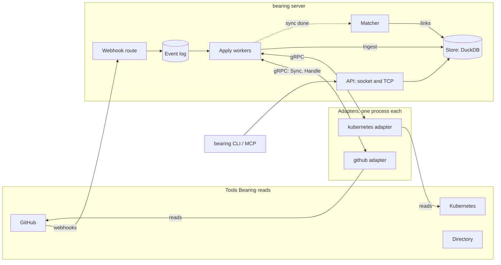
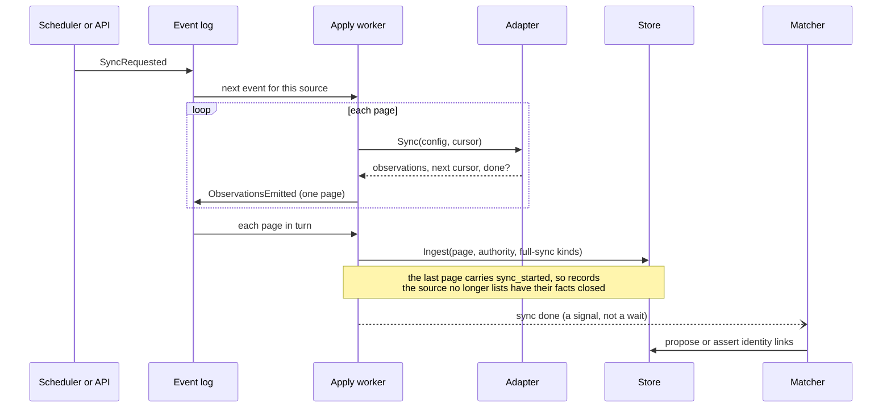
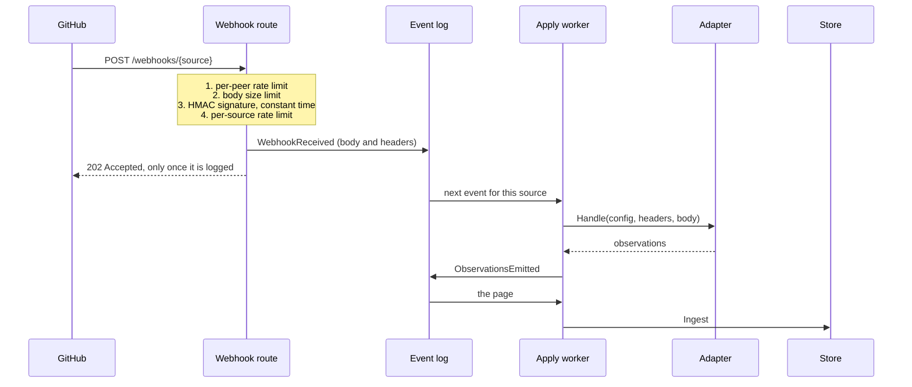
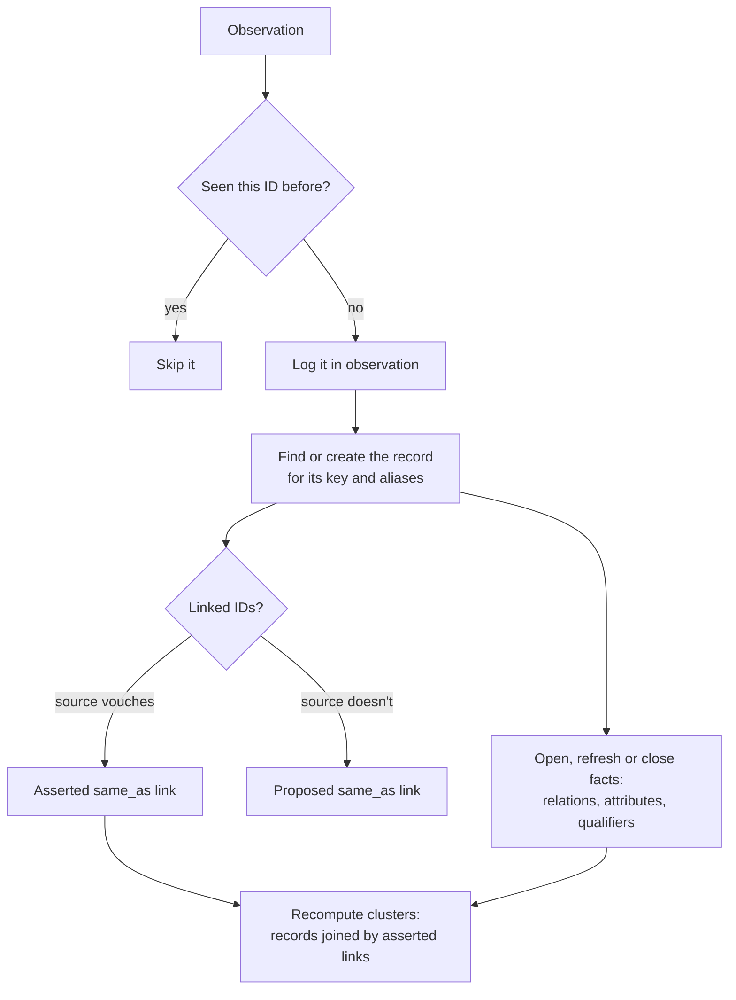
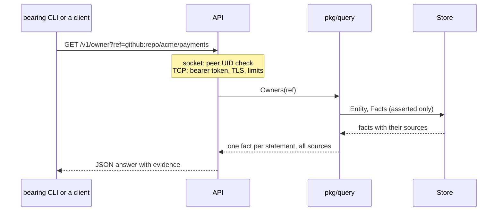

# How Bearing works inside

A tour of the running server for someone new to the code. Each section has a
diagram and the packages to read next. The decisions behind it are in
[`docs/adr/`](adr/); the words (observation, record, fact, link) are in
[concepts](spec/concepts.md).

## The big picture

- **Adapters** (`adapters/*`, `pkg/adapter`) only read a source and turn
  what they see into observations. The server starts each one as its own
  process and talks to it over gRPC on a private Unix socket, or reaches a
  remote one over TLS with a token.
- **The event log** (`pkg/store`, `internal/duckstore/eventlog.go`) is the
  server's to-do list. Everything that will change the graph is written there
  first, so nothing is lost if the server stops halfway.
- **Apply workers** (`pkg/server`) take events off the log in order, one
  worker per source, and do the work: call the adapter, then ingest what it
  returned.
- **The store** (`internal/duckstore`, behind `pkg/store` and `pkg/graph`)
  keeps observations, records, identity links and facts, and answers
  questions.
- **The matcher** (`pkg/match`) looks for records that describe the same
  thing after each sync and proposes links between them.

## A sync

A sync reads everything a source has, page by page. It starts on a schedule
or when someone runs `bearing source sync`.

- Pages are logged before they are ingested, so a crash replays them; the
  store skips an observation it already has.
- Only the **last page of a full sync** says "this is everything", and only
  then does the store close what the source stopped listing. Its time comes
  from the adapter's own clock (the earliest observation of the sync).
- Matching runs on its own goroutine, so a slow match never holds up the
  next sync.

Read next: `pkg/server/events.go` (`handleSync`, `handleObservations`),
`pkg/server/apply.go`, `internal/duckstore/ingest.go`.

## A webhook

A source can also push a change as it happens. The server checks the
delivery, logs it and answers at once; the adapter turns it into
observations later.

- **The server owns verification.** The route uses the signature scheme the
  adapter's declaration names and the secret from the server's settings. A
  bad or missing signature and an unknown source get the same `401`, so a
  stranger learns nothing.
- **The adapter never needs the webhook secret.** By the time it sees a
  delivery, the server has checked it and logged it. (Today the GitHub
  adapter still checks again, with a secret the server deliberately doesn't
  give it, so deliveries fail; removing that check is pending.)
- A webhook page is never a full sync, so it doesn't close anything and
  doesn't start matching.

Read next: `pkg/server/ingest.go` (`serve`), `pkg/server/verify.go`,
`pkg/server/events.go` (`handleWebhook`).

## Inside an ingest: records, links and facts

Each `Ingest` call is one transaction: everything in it lands, or nothing
does.

- A **record** is one thing as one source described it. An **entity** is a
  cluster of records joined by **asserted** `same_as` links; answers are
  about entities.
- A **proposed** link joins nothing until a person or a rule in the settings
  asserts it. Answers about ownership and dependencies read asserted facts
  only.
- Closing a link splits the cluster again, and every fact stays on the record
  that observed it, so a wrong join can be undone.

Read next: `internal/duckstore/ingest.go`, `links.go`, ADR 7.

## A question

Read next: `pkg/server/api.go`, `pkg/query`, [the API spec](spec/api.md).
