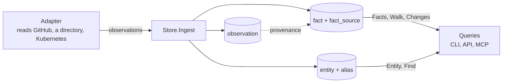

# Concepts

How Bearing turns what your tools say into answers you can check. The
decisions behind this page are [ADR 2](../adr/0002-facts-carry-provenance.md)
and [ADR 6](../adr/0006-small-data-model.md); the fields are defined in
`proto/bearing/model/v1alpha1/observation.proto`.

## Observation

An **observation** is one adapter's report about one thing at one moment:
"repository `acme/payments-api` exists, its language is Go, and the
`payments` team approves its changes". It has an ID, the time the source was
read, the thing's **key**, and what was seen about it.

Bearing keeps every observation exactly as it arrived. An observation with
an ID it already has is skipped, so sending the same data twice is safe.

## Key

A **key** names a thing in one system: `github:repo/acme/payments-api`,
`authentik:user/7f3c…`, `email:person/jane@acme.example`. The shape is
`<system>:<type>/<id>`. A key never changes meaning: if a repository is
renamed, the adapter keeps its stable ID in the key and the new name in an
attribute.

## Entity

An **entity** is one real thing: a service, a repository, a person, a team.
Every key that names it is an **alias** of it. When one observation names
keys that Bearing had filed under two entities of the same kind (a GitHub
user and a directory person, linked by the directory), the two are merged
into the older one, and the newer one's keys and facts move to it.

## Fact

A **fact** is one statement about an entity over a span of time:

| Part | Example |
| --- | --- |
| Subject | the `payments-api` repository |
| Predicate | `approves_changes` |
| Object or value | the `payments` team (a relation), or `"Go"` (an attribute) |
| Valid from, valid to | when a source first saw it, and when it saw it end (empty while it holds) |
| Status | `asserted` (from a source's own records) or `proposed` (inferred, never used to answer ownership or dependency questions) |
| Confidence | 0 to 1 |
| Sources | the observations behind it |

A fact **opens** the first time a source reports it, is **refreshed** each
time the source reports it again, and **closes** when the source says it
is gone: the relation is marked absent, a full listing no longer includes
it, the attribute has a new value, or the thing was deleted.

## Provenance

Every fact keeps the observations behind it. An answer such as "the
payments team owns payments-api" comes with "because GitHub's CODEOWNERS
said so, seen at 06:00, here is the link". When two sources say the same
thing, the answer shows both.

## Time

There is one time line: when a source observed something. Asking "who
owned this last Tuesday?" reads the facts that held then; "what changed
this week?" lists the facts that opened or closed in it.
